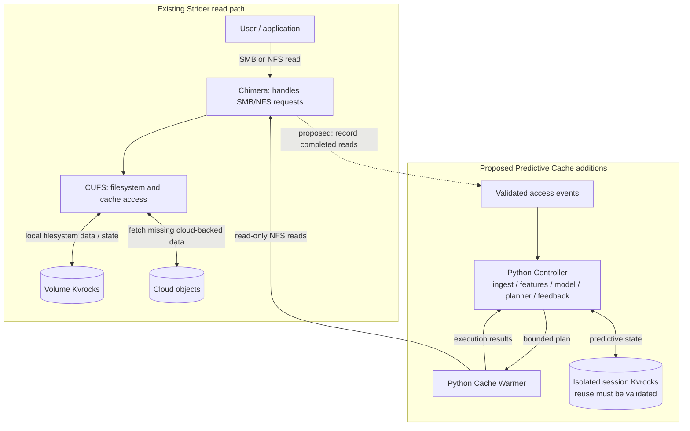
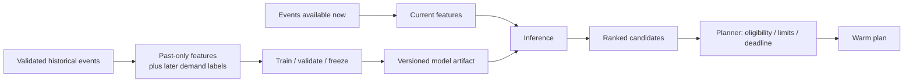

# Predictive Cache

<<<<<<< Updated upstream
> **Status:** synthetic data generation is implemented; the Controller, Warmer
> service and real-workload performance claims remain separate work.
> Generated records model fictional activity and never read personal files.
=======
Predict which files a team will read next, then fetch selected data before
users wait for it to arrive from cloud storage.
>>>>>>> Stashed changes

> **Status: design proposal.** The repository contains plans and specifications,
> not an implemented Controller, Warmer, data pipeline or benchmark. Diagrams
> and examples below describe the intended system; they do not establish that
> the required telemetry or cache controls already work.

<<<<<<< Updated upstream
## Run the datagen foundation

Python 3.12 and `uv` are required. From the repository root:

```bash
uv sync --locked
uv run pcache-datagen generate --preset tiny --out /tmp/pcache-tiny
uv run pcache-datagen validate /tmp/pcache-tiny
uv run pcache-datagen describe /tmp/pcache-tiny
uv run pytest
uv run ruff check .
```

Use a new output directory for each run. `--format jsonl` selects JSONL instead
of Parquet. `--config scenario.yaml` selects a YAML config instead of `--preset`;
`--seed` and `--format` override it. `--overwrite` replaces only an intact,
verified generator-owned dataset without unrelated files.

The generator includes popularity/lifecycle demand, schedules, task chains,
shared bursts/scans, batch jobs, new files and unrelated noise. It emits
open/read/close records with ranges and totals, actor sessions, file changes,
and configurable telemetry faults. Outputs retain the v1 schemas, synthetic
provenance, separate pattern truth and reconciled loss counters.

Use YAML with `--config` to adjust existing controls. For smaller ingestion
fixtures, lower `files.target_count`, `actors.users`, `period.weeks`, and
`randomness.rate_scale`; `realize.read_events: none` keeps open/close totals
while omitting per-range rows. No modeled file contents are created.
`validate` checks schemas and artifact integrity. Fault-stage denominators
are included in `report/quality.json`; full recovery reports and scale tuning
remain #19. Generation is buffered in memory, and writes do not feed back
into previously generated access choices. See [spec §20](docs/datagen/spec.md#20-combined-workloads-realization-and-faults-issues-1618).

## What we are trying to prove
=======
## System diagram
>>>>>>> Stashed changes

There are two paths. The **normal read path** serves users. The **background
warming path** observes activity and makes extra, bounded reads ahead of demand.



Solid arrows show intended requests and record transfers. The dashed arrow
marks an observation integration that still needs validation. File bytes
return through the read path; they do not pass through the Controller.
Observations could instead come from an instrumented client for a scoped lab
experiment. That would cover that client's workload, not all appliance traffic.

**Normal reads never wait for the Controller, event collection or predictive
state.** Those components are not in the foreground response path. The Warmer
still shares cache, network and storage resources with users, so contention
must be measured and controlled.

### What each component does

| Component | Responsibility |
| --- | --- |
| Chimera | Receive SMB/NFS file requests from clients and pass them to CUFS. |
| CUFS and volume Kvrocks | Existing filesystem data/state and cache access. The project does not write predictive records into this store. |
| Controller | Turn observed accesses into features, predictions and bounded plans; correlate results with later demand. |
| Warmer | Read approved file ranges through NFS, enforce limits and report what completed. |
| Predictive state | Store events/features, plans and results separately from volume state. Session Kvrocks reuse is conditional on isolation and compatibility checks. |
| OTel / Grafana | Observe and explain runs. Metrics are not automatically a complete file-access history. |

We add **two deployables: Controller and Warmer**. Feature extraction,
prediction and planning are modules inside the Controller. The Warmer is
separate so it can be constrained and stopped independently.

### Basic terms

| Term | Meaning here |
| --- | --- |
| Foreground demand | A user's or application's actual work, including batch work. Warming is extra work performed ahead of that demand. |
| Cold / warm | A cold range needs missing data fetched; a warm range is already available in the cache being tested. Judge the requested range, not just the whole file. |
| Byte range | A portion of a file identified by an offset and length. Offset 0 and length 65,536 mean the first 65,536 bytes. |
| Fault | Fetching missing cloud-backed data so a filesystem operation can proceed. |
| Co-access | Files read close together within a validated session. The model tests whether that association helps predict later demand. |
| Feature | One input value used to make a prediction. For example: how many times was this file read in the last 10 minutes? |
| Feature row | All the input values for one file at one prediction time. For example: its recent read count, time since last read and size. |
| Label | The answer learned later: was the file actually read within the prediction window? It is used for training or evaluation. |
| Cache pollution | Speculative data displaces useful data or competes for resources, harming other work. |

### Example: a feature row and a label

These numbers are fictional. At 09:00:01, we want to predict whether file B
will be read in the next five minutes. We build this feature row from what
we know at 09:00:01:

| File | Prediction time | Reads in the last 10 minutes | Seconds since last read | File size in bytes |
| --- | --- | --- | --- | --- |
| B | 09:00:01 | 0 | 1200 | 1048576 |

The file and prediction time identify the row. The three values after them
are features: 0 recent reads, 1200 seconds since the last read, and a size
of 1048576 bytes. This is a small example, not the final feature list.

At 09:03, the user successfully reads B. We can now attach the label
"yes, B was read within the five-minute window" to that earlier row.
We did not know this answer at 09:00:01.

Training uses past feature rows and their later labels. When making a new
prediction, the model receives the features without the future label.
If no read is observed, we can label the row "no" only after the full
window ends and we know that collection was sufficiently complete.

## Follow one read through the system

Consider a project where reading file A is often followed by reading file B.
This is a fictional example, not a measured workload.

1. **The user reads file A.** Chimera receives the request and passes it to
   CUFS. CUFS reads the requested data. If that data is missing locally,
   CUFS fetches it from cloud storage.
2. **Record what happened.** The proposed collector sends the Controller a
   small record: which file and bytes were read, when, whether the read
   succeeded, and whether it came from a user or the Warmer. Missing or
   uncertain information stays marked as unknown.
3. **Estimate whether B will be needed.** The Controller builds a feature row
   using information it already has. The model gives each eligible file a
   score. B is one file being considered for warming; a score does not
   instruct the Warmer to read it. Using a model to make this estimate is
   called inference; it does not require training the model again.
4. **Decide whether to read B now.** The planner checks that B is allowed, the
   file identity is still correct, and the work fits the deadline and resource
   limits. It may skip B even with a high score: B could cost too much to
   fetch or the information could be stale. It may also skip data already
   cached, when we have a reliable way to check.
5. **The Warmer reads the chosen part of B.** It makes an ordinary NFS read
   through Chimera and CUFS. It reads only the approved byte range.
6. **The Warmer reports the result.** It tells the Controller how many bytes
   came back, when the read ran, and what failed. A completed read does not
   prove the data stayed in the cache.
7. **Check whether the user later reads B.** If that happens, compare the
   bytes the user read with the bytes the Warmer read. To show that warming
   actually saved waiting time, we still need a comparable run without it.
   The data might have been cached already.

### Where is the queue?

SMB/NFS clients still issue ordinary reads. Our proposed work queue contains
**background warming tasks**, created by the Controller. User reads are never
placed in that queue or rescheduled by this project.

The queue transport and claim/retry protocol are not frozen. Plan/result
files can connect development fixtures before the live transport exists;
they do not establish a production queue. Atomic claims, idempotency, leases,
retry limits and stale-worker handling need validation before concurrent use.

## Data flow and formats

The Controller deals in **metadata records**, not file contents. Keep these
records distinct:

| Record | Question it answers | Producer -> consumer |
| --- | --- | --- |
| Access event | What operation happened? | Validated source -> ingestion |
| Feature row | What did we know about a candidate at prediction time? | Feature builder -> model |
| Prediction | What might be needed soon? | Model -> planner |
| Plan / task | What are we allowed to read now? | Planner -> Warmer |
| Warm result | What did the Warmer actually read? | Warmer -> feedback / evaluation |
| Dataset / run manifest | Where did these records come from, and how was the experiment configured? | Data / evaluation owner -> all stages |

Use UTC timestamps and byte units. Keep `volume_id` and opaque `file_id`
separate from a mutable path. A rename or replacement must not cause the
Warmer to read a different object accidentally.

### 1. Access event: an observed read

<<<<<<< Updated upstream
In the earlier source investigation, a representative CUFS code path traced
`cufs_op_read` through `cufs_ll_read` and `File::read` to `Dkv::readData`,
with stubbed chunks leading to faulting and a retry. The report cites
`cufs/src/vfs_cufs/cufs.c:1381-1482` and
`cufs/src/fsal_cufs/file_impl.cpp:400-480` at the investigated revision; see
the [sources](#sources). This is a useful starting point for the filesystem
owner, **not verification of the currently deployed image or a guarantee
that a separate NFS warm remains resident**. Re-trace the deployed version
and verify any telemetry hook with its maintainers.

### Why two services and why read through NFS?

The feature extractor, model, planner and feedback share data and a fast
iteration cycle, so combining them avoids prematurely introducing several
network APIs and deployments. The Warmer has a different failure and
resource profile: speculative reads consume I/O and may contend with
foreground traffic, so it needs an independently enforceable budget and stop
control. Separate deployment is a control boundary, not a guarantee of
isolation; shared network, storage and cache still need measurement.

Read-through NFS reuses the ordinary protocol path and avoids assuming a new
CUFS API or writing directly to filesystem storage. Its costs include protocol
overhead, authorization, possible client-side caching, and difficulty
attributing the read and proving that the desired CUFS range stayed warm.
A future direct API might offer more explicit intent and prioritization, but
would require an owned API, semantics, security and tests. Neither option
solves model quality or cache-pollution risk on its own.

### Warming path and safeguards

The recommended MVP is read-only, bounded userspace NFS reads through the
existing Chimera → CUFS path. First prove that those reads actually materialize
the intended CUFS data and that the benefit survives until a later foreground
read. Verify NFS authentication, range handling, cache residency, and
measurement semantics. A direct CUFS prefetch API is a possible future
design, **not a confirmed existing API**. If read-through cannot provide a
durable effect, stop and reconsider the mechanism rather than claiming success.

The Warmer must not block foreground reads or become a foreground dependency.
Use bounded concurrency, bytes in flight, request and bandwidth rates,
per-volume and per-file limits, deadlines, cancellation, cooldown, and a
foreground-pressure pause. CPU/memory limits alone do not guarantee network or
storage bandwidth limits. Enforce an explicit byte/cache-space budget, avoid
already-resident work when residency can be established, and monitor eviction
and unrelated workloads for pollution.

Mark and **exclude warmer-origin events** from demand features, labels, and
evaluation so warming cannot recursively train or trigger itself. Validate
the marker and filtering at the actual collection point; a service account
or suppression window alone is not proof of correct attribution. Telemetry
must be bounded and nonblocking: collection or prediction failure must not
change the result of a foreground read.

### Kvrocks boundaries

| State | Role and boundary |
| --- | --- |
| CUFS volume Kvrocks | Existing filesystem state. Do not write predictive state into its private schema or treat it as a general-purpose queue. |
| Session Kvrocks | A separate instance observed historically and **proposed** for predictive events/features, scores, plans, leases, and results under isolated, versioned prefixes and TTLs. Reuse depends on verified access, command support, capacity, retention, and workload isolation. |
| Dedicated predictive Kvrocks | Fallback if session-store isolation, capacity, or compatibility is inadequate; provision only after the relevant owners approve it. Do not fall back to volume Kvrocks. |

Model artifacts belong in a versioned image or artifact store, rather than
assuming Kvrocks is a model-binary store. Validate atomic claim, lease expiry,
idempotency, bounded retries, and recovery semantics before selecting a queue
design. Separate experiment/run and volume namespaces, use least privilege,
and record retention and cleanup ownership.

For illustration, a predictive namespace might organize keys by version and
volume, with separate records for events, features, scores, plans, task
leases, and results. Namespacing alone is **not** resource isolation: verify
quotas, access controls, retention, capacity and contention with the store
owner. A lease is temporary ownership of a task, not proof that the task
completed. On expiry, a new worker may need to retry; it must not double-count
results or let concurrent workers exceed a global budget. Confirm the
deployed store's atomic operations and failure behavior before depending on
any specific Redis-compatible command or queue design.

### Failure and state ownership

| Failure or race | Required behavior / design question |
| --- | --- |
| Event queue full or exporter unavailable | Never delay or fail the foreground read. Drop or coalesce according to an explicit policy, count the loss, and treat affected data as incomplete. |
| Controller or predictive store unavailable | Foreground reads continue normally. Stop issuing new work or expose degraded readiness; use bounded retries and queues. Do not silently substitute CUFS volume state. |
| Warmer restart, timeout, or duplicate delivery | Record partial results, make retries idempotent, and define lease expiry and ownership. A lease alone cannot prevent an old worker from continuing after expiry; the execution design must handle that race. |
| File renamed, replaced, truncated, or permission changed | Revalidate identity, allowed path and bounds near execution. Skip or fail safely rather than reading a different object or assuming a stale path is authoritative. |
| Foreground pressure or low cache headroom | Pause/cancel or reduce speculative work under agreed policy; observe actual in-flight work and foreground recovery. |
| Metrics or origin attribution missing | Surface incomplete evidence. Do not count unknown-origin traffic as demand or claim success from an unobservable run. |

## Access data and contracts

### Establish the evidence first

For the synthetic development dataset, see the
[datagen implementation spec](docs/datagen/spec.md) and
[decisions and model-team handoff](docs/datagen/decisions-and-handoff.md).
These describe generated access records, not collection of local or cluster
activity, and do not change the real-evidence requirements below.

There is **no confirmed representative historical access dataset** in this
repository or in the supplied evidence. Ask the data and filesystem owners
which authorized structured sources exist, what time span and workloads they
cover, and whether their events can be used in the lab. Existing logs or audit
events may lack required fields. If they do, assess a minimal nonblocking
CUFS telemetry hook with the owners; do not infer missing semantics from
unstructured logs. Synthetic fixtures are useful for deterministic plumbing
and contract tests only; they cannot establish real-workload model quality or
a product-performance claim.

Proposed versioned event schema (field availability and semantics are gates):

| Field | Intended purpose and questions |
| --- | --- |
| `schema_version`, `event_id`, `timestamp` | Version, deduplicate, and order observations; assess clock quality, late arrival, loss, sampling, and duplicates. |
| `volume_id`, opaque `file_id`, current path | Identify and locate the target. An earlier proposal suggested inode plus generation; availability, reuse, rename/replacement behavior, generation semantics, and safe path resolution are **unverified**. Do not assume inode alone is globally stable. |
| `operation`, `offset`, requested and actual bytes, result | Define the accessed range and successful demand. Confirm which open/read/range and outcome details are recorded. |
| `origin` | Distinguish foreground from warmer/synthetic activity and exclude the latter. Verify this end to end. |
| Opaque cohort/session key, application | Support co-access and workload segmentation if legitimately available; cohort identity and privacy characteristics are **unverified**. |
| Fault/cache outcome, latency | Help distinguish cold demand and measure effects. Availability and the meaning of fault/residency signals are **unverified**. |

Do not collect file contents, raw usernames, credentials, or unnecessary
identifying paths. Agree with data owners on authorization, pseudonymization,
volume allowlists, access controls, retention, and deletion. Produce an
immutable dataset manifest with source, collection period, schema and
anonymization versions, counts, known gaps, and quality checks. Document
whether missing events reflect no demand or incomplete collection.

Define the prediction unit and horizon before labeling. For example, label a
file/range as useful only if a later **foreground** read consumes it within
the declared usefulness window. Construct labels after the feature cutoff;
exclude warmer events and avoid treating missing data as a reliable negative.
Ensure windows crossing the train/validation/test boundaries cannot leak
future demand.

#### Illustrative event and label

This example shows a possible shape, **not an existing schema or a statement
that these fields are currently available**. IDs and paths are placeholders;
an implementation must apply its approved privacy policy.
=======
The field names below follow the [datagen planning schema](docs/datagen/spec.md#51-access-event-events-truthdropped_events).
This is a **readable subset**, not a complete validated production event.
Optional context is omitted. Real-source field availability remains open.
>>>>>>> Stashed changes

```json
{
  "schema_version": 1,
  "event_id": "ev-001",
  "event_time": "2026-11-03T09:00:00.000000Z",
  "ingest_time": "2026-11-03T09:00:00.010000Z",
  "volume_id": "vol-001",
  "file_id": "file-a",
  "dir_id": "dir-project",
  "operation": "read",
  "offset": 0,
  "bytes_requested": 65536,
  "bytes_read": 65536,
  "file_size": 1048576,
  "result": "ok",
  "origin": "foreground",
  "cache_outcome": null,
  "latency_ms": null
}
```

`event_time` is when the read happened; `ingest_time` is when it became
available to the collector. A late event cannot become a feature for a
prediction that happened before its arrival. Requested bytes and returned
bytes differ on short reads or errors. `null` cache or latency fields mean
unknown, not a hit, a miss or zero latency.

Datagen v1 writes partitioned **Parquet** by default, with **JSONL** available
for small fixtures. JSONL is one JSON record per line. The generator's
[output layout](docs/datagen/spec.md#3-output-layout) also contains a catalog,
loss counters and a manifest. It does not simulate cache state or latency.
These are proposed generator outputs, not proof of a live Strider exporter.

### 2. Feature row and prediction: an estimate

For B at 09:00:01, features might include its earlier read count, time since
last read, size and prior co-access with A. These are derived values, not
fields that a filesystem necessarily emits.

An illustrative prediction is:

```json
{
  "model_version": "demo-model-001",
  "prediction_time": "2026-11-03T09:00:01.000000Z",
  "volume_id": "vol-001",
  "file_id": "file-b",
  "horizon_seconds": 300,
  "score": 0.82
}
```

The score ranks a candidate; it is not an 82% probability unless calibration
establishes that meaning. A five-minute horizon is a starting proposal from
the team plan, to be checked against retrieval lead time.

### 3. Warm plan: a bounded instruction

For this example, select the first 65,536 bytes of B. Actual range selection
must be justified by the workload; an arbitrary prefix may not help an app.
The following plan/result formats are **illustrative**, not frozen APIs.

```json
{
  "schema_version": 1,
  "run_id": "demo-run-001",
  "plan_id": "plan-001",
  "model_version": "demo-model-001",
  "deadline": "2026-11-03T09:05:01.000000Z",
  "max_bytes": 65536,
  "items": [{
    "task_id": "task-001",
    "volume_id": "vol-001",
    "file_id": "file-b",
    "path": "/approved/project/file-b",
    "offset": 0,
    "length": 65536
  }]
}
```

Here `max_bytes` means total **requested read bytes across all attempts**,
including retries. This plan has no spare allowance for a retry after a full
65,536-byte request. It does not cap cloud bytes or cache occupancy: existing
fetch granularity and prefetch can amplify traffic. Revalidate identity,
permissions and range bounds before execution; a path alone is insufficient.

### 4. Warm result: execution, not effectiveness

```json
{
  "schema_version": 1,
  "run_id": "demo-run-001",
  "plan_id": "plan-001",
  "task_id": "task-001",
  "status": "completed",
  "bytes_requested": 65536,
  "bytes_read": 65536,
  "started_at": "2026-11-03T09:00:02.000000Z",
  "finished_at": "2026-11-03T09:00:03.000000Z"
}
```

Record partial, skipped, failed and cancelled tasks separately. If a later
foreground read at 09:03 consumes the same range, that supplies usefulness
evidence. It does not, by itself, establish a saved cloud fault or latency gain.

The example `run_id` links plans, results and experiment configuration.
Datagen v1 access rows do **not** contain `run_id`; associate their dataset or
source with a run in experiment metadata rather than silently adding a field.

### Origin and dataset provenance are different

`origin` identifies traffic within an observed system: `foreground`,
`warmer`, `synthetic` probe traffic or `unknown`. Only trusted foreground
events can become real-demand features and labels; missing origin is unknown.

A generated dataset can contain rows with `origin: "foreground"` to simulate
user demand. Its manifest still has `data_kind: "synthetic"`. Those rows
remain fixtures for plumbing or pattern-recovery checks. They are not real
history or evidence of real-workload model quality or performance.

Keep datagen's `truth/` outputs out of features, models, planners and the
Controller. Tests can use them to check planted patterns and faults. Catalog
metadata also needs an as-of-time view; future deletions or replacements must
not leak into a prediction. Collect no file contents, raw usernames,
credentials or unnecessary identifying paths; never commit real access data.

## Training, prediction and feedback

Training learns a model from historical examples. Inference applies that
model to current features. Planning decides how much work is worth issuing.



For a training row at 09:00:01, only information available by that time is
eligible as a feature. A successful read of B at 09:03 can later supply a
positive label for the five-minute horizon. It cannot appear in that row's
features. An absent read is a negative only when observation of the whole
window is sufficiently complete; otherwise the label is unknown.

Start with most-recently-used, frequency and static hot-set baselines.
The 48-hour plan proposes one lightweight trained classifier, with recency,
frequency, size and validated co-access features. The original time-of-week
and graph/blend ideas are candidates for comparison, not mandatory separate
services. Weekly claims need adequate real history. Algorithm, horizon and
planner objective remain design choices to validate.

Split chronologically into training, validation and untouched test periods.
Fit transformations and tune thresholds on the appropriate earlier data;
freeze them before test evaluation. A new event can change a prediction
without retraining. Warm results inform accounting and safety; only later
independent demand can supply demand labels. Retraining is a separate step.

## State and failure boundaries

| Information | Intended home / boundary |
| --- | --- |
| Customer file data and CUFS state | Existing volume Kvrocks / cloud path. No predictive writes to its private schema. |
| Events, features, scores, plans and task results | Isolated, versioned prefixes and TTLs in session Kvrocks, only after validating compatibility, access and contention. |
| Model artifact | Versioned file, image or artifact store; not assumed to be a Kvrocks model-binary store. |
| Run evidence | Approved private storage for raw data; sanitized manifests and reports in shared docs. |

Namespacing is not resource isolation. If session-store reuse fails its
checks, obtain approval for a dedicated store; never fall back to volume
Kvrocks. JSON/Parquet records are metadata; NFS reads carry file bytes;
OTel carries measurements. They serve different purposes.

Stop or reduce speculative work on pressure, deadline expiry or uncertain
control state. Bound concurrency, bytes in flight, issued bytes, retries and
duration. Missing collection, stale identities and partial results must be
visible. Prediction or telemetry failure must not block normal reads.
Stopping the Warmer does not undo data already fetched into cache.

## Hackathon scope and parallel work

The active team plan targets **48 hours, 3-4 engineers and Python**, using one
vCenter cluster, one volume, NFS and a bounded candidate set. vCenter is the
explicit team choice; generic Kind instructions elsewhere are not a request
to redeploy this environment. Go needs a concrete reason and user approval.

| Workstream | First shared output |
| --- | --- |
| A: Data and evaluation | Event contract, quality checks, replay and baseline output. |
| B: ML and planning | Features, trained model, ranked candidates and versioned plans. |
| C: Strider and Warmer | Authorized test volume/mount, cache probe and bounded NFS execution. |
| D: Optional fourth engineer | Independent trials, pressure tests, results display and demo packaging. |

Agree on contracts by H1; target an integrated run by H16, first comparison
by H24, integration freeze by H32 and backup recording by H40. These are
schedule targets, not evidence-gate passes. With three engineers, A also owns
trial validity/display and C owns integration.

Use the [quick glance](docs/plan/team-quick-glance.md),
[three-page PDF](artifacts/pdf/predictive-cache-48-hour-team-plan.pdf) or
[detailed plan](docs/predictive-cache-48-hour-team-plan.md) for the schedule.
The earlier working-week estimates are historical planning context, not the
current hackathon timetable. Reinspect the target environment before tests;
a deployed cluster alone does not prove registration, volume readiness,
event capture or warming behavior.

## Milestones and go/no-go gates

The named gates below define what the team can claim. They are separate
from the schedule's M0-M7 checkpoints.

1. **Feasibility:** demonstrate persistent NFS read-through benefit; validate
   origin/events, session-store isolation, authorized representative data
   access and equivalent cold reset. Stop or redesign if these fail.
2. **Data baseline:** publish an authorized versioned dataset, quality report,
   deterministic replay, simple baselines and a no-warmer noise floor.
3. **Offline model:** freeze models and thresholds, then compare against
   MRU/frequency/static baselines on held-out real data at equal byte budgets.
4. **End-to-end prototype:** exercise Controller plans, correlated feedback,
   bounded Warmer execution, origin exclusion, recovery and foreground safety.
5. **Proof and readout:** run matched trials; report uncertainty, foreground
   impact and cache pollution; obtain a second engineer's reproduction before
   claiming success.

A faster selected read is insufficient if other foreground work regresses.
Without verified cold-state equivalence, limit the result to an observational
study. Without suitable real data, real-workload model-quality evaluation
stays blocked. Synthetic fixtures cannot close either gap.

## What to read next

| Need | Document |
| --- | --- |
| Day-to-day schedule and ownership | [Quick glance](docs/plan/team-quick-glance.md) and [detailed team plan](docs/predictive-cache-48-hour-team-plan.md) |
| Full generation schema, dataset layout and synthetic patterns | [Datagen spec](docs/datagen/spec.md) |
| Collection, state, failure and benchmark procedures | [Validation and operations](docs/architecture/validation-and-operations.md) |
| Gate owners and required evidence | [Checkpoint map](docs/plan/milestones.md) |
| Contributor and agent procedures | [AGENTS.md](AGENTS.md), [handbook](docs/ai/contributor-handbook.md) and [workflow](docs/ai/workflow.md) |

The README owns the architecture, concepts, illustrative interfaces and
evidence gates. Linked documents supply procedures, planning detail and the
generator's planning schema. Shared live contracts still need to be agreed.
GitHub issues and the [project board](https://github.com/users/rahulgtt/projects/3)
hold the backlog. `$pc-milestone` coordinates agent work; it is not part of
the product runtime.

## Sources

This revision reconciles the [48-hour plan](docs/predictive-cache-48-hour-team-plan.md),
[quick glance](docs/plan/team-quick-glance.md) and
[datagen specification](docs/datagen/spec.md). Earlier investigations,
environment observations and source limitations are retained in
[the reference notes](docs/architecture/validation-and-operations.md#sources).
No benchmark or deployed-source capability is established by this README.
