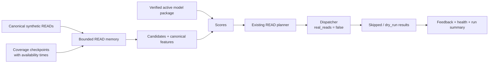

# READ replay controller

`pcache-controller replay-read` connects canonical READ observations to features,
model scoring, bounded plans, the existing Dispatcher and feedback. It runs on
synthetic fixture metadata with invented execution handles. Real reads cannot be
enabled by this command.



This is separate from `run-pass2`, which consumes an already frozen prediction
schedule. READ replay computes predictions at each processed tick. Generic
`run` and `replay` ingestion commands retain their existing lifecycle semantics.

## Inputs

The command takes one YAML configuration. Paths are absolute or relative to
that configuration file. The Dispatcher root must already be empty, owned by
the running UID and mode `0700`; it cannot be an existing experiment root.

```yaml
schema_version: 1
volume_id: vol-1
run_id: fixture-replay-001
controller_id: read-replay
events: events.jsonl
coverage: coverage.jsonl
model_pointer: pointer.yaml
dispatcher_root: dispatcher
start: "2026-11-04T09:00:00Z"
ticks: 3
verified_file_size: false
limits:
  max_events: 100000
  max_files: 10000
  max_coverage: 10000
  max_replay_seconds: 3600
```

`events.jsonl` contains canonical
[`ReadDemandEvent`](../../src/predictive_cache/semantics/read_demand.py) rows,
one complete JSON object per line. Raw Chimera envelopes and generic datagen
rows must first use their reviewed canonical projection. No OPEN/CLOSE records
are fabricated. The command rejects `data_kind: real`; fixture and controlled
synthetic demand are admitted explicitly. Warmer and unknown traffic are
excluded. Fixture timestamps require `event_time <= known_at`.

`coverage.jsonl` contains checkpoints with exactly these fields:

```json
{"volume_id":"vol-1","hour_start":"2026-11-04T08:00:00Z","status":"complete","known_at":"2026-11-04T09:00:00Z","observed_through":"2026-11-04T09:00:00Z"}
```

`hour_start` is an aligned UTC hour. `observed_through` is inside that hour and
cannot follow `known_at`. A tick may use only checkpoints already available at
that tick. A current-hour checkpoint must cover through the tick itself;
advancing past its extent withdraws completeness until another checkpoint
arrives. A historical hourly coverage table without availability times is not
sufficient for this input. Do not invent timestamps to make it pass.

The canonical recency feature needs complete seven-day context. For a tick at
09:00, that means all overlapping hourly buckets in the preceding seven days.
The next tick at 09:01 additionally needs a current-hour checkpoint observed
through 09:01. Missing context remains null and suppresses plans. The READ
frequency fallback also refuses unknown 24-hour counts.

`pointer.yaml` uses the existing [ModelManager contract](model-manager.md):

```yaml
model_uri: file:///approved/models/read-model.zip
feature_version: read-demand-fv1
fallback: baseline-read-frequency
```

The runtime advertises canonical READ semantics and anchor support. File-size
model support defaults to false. Enable it only for fixture input carrying the
required fixture metadata. A package requiring unavailable features is refused;
the package cannot expand runtime capabilities. Narrow offline MVP packages do
not silently become canonical full-profile packages.

## Run and inspect

Run in the designated CUFS/Chimera build container on `nas-vm`:

```bash
mkdir -m 700 /approved/replay/dispatcher
uv run pcache-controller replay-read --config /approved/replay/replay.yaml
```

Each tick uses all observations with `known_at <= t`. It selects recent,
neighbor and popular candidates within one volume, computes the existing READ
features and scores them with one coherent model bundle. Model activation occurs
only between ticks. Cadence comes from that bundle's policy. An overrun above
80% of the tick interval finishes normally and skips the next scheduled slot.
Input buffers, retained history, candidate counts, ticks and duration are bounded.
Retention exhaustion or conflicting evidence latches a gap; history is never
silently evicted. This experimental memory has no checkpoint/restart support.

The planner retains its five-minute forecast and target-bounded execution
deadline. The Dispatcher consumes each generated plan immediately on the replay
clock. Results retain requested bytes, record `bytes_read: 0` and create no
Warmer task process. Feedback joins only the expected owner-only result files
to the original validated tasks. Synthetic READs never count as real usefulness.

The private root contains plans, Dispatcher evidence, bounded prediction JSONL,
`read-replay-summary.json` and `read-replay-metrics.prom`. Generated files are
mode `0600`. The printed summary contains aggregate health, missing-score counts,
tick timings and feedback; handles and source paths are excluded. A reported
fixture p95 measures this replay only.

## Validation and remaining work

The focused suites cover feature parity, visibility boundaries, coverage expiry,
candidate/anchor rules, exclusions and memory limits; model swaps, readiness,
overruns and publication failures; and actual plan-to-Dispatcher dry-run result
joining plus CLI input/output boundaries.

```bash
uv run pytest tests/controller/test_read_memory.py \
  tests/controller/test_read_runtime.py tests/controller/test_read_replay.py
```

This does not establish live Chimera collection, trusted foreground attribution,
live TargetMap integration, durable recovery, cache residency, model quality or
foreground performance. Those remain separately gated. Never repurpose the
synthetic handles or replay root for live warming.
