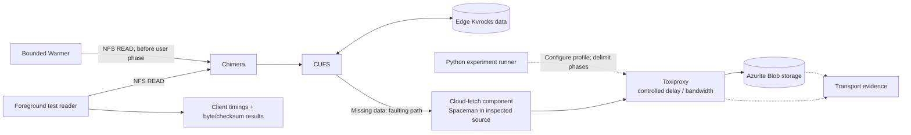

# Foreground latency lab: cloud storage behind a throttling proxy

**Status:** implementation plan, not a deployed or validated experiment.  
**Prepared:** 4 November 2026.  
**Intended repository path:** `docs/experiments/foreground-latency-lab.md`.

## 1. What we want to demonstrate

Show that a user read waits longer when CUFS must retrieve data from object
storage, and that completing a bounded warm read beforehand can remove some
of that wait. Measure actual client-observed read latency, rather than infer
cache hits from unrelated Kvrocks counters.

Start with a controlled storage experiment, without the prediction model.
Warm exactly the future test range as a positive control. Once that works,
replace that selection with the Controller's predictions and compare them
with a simple MRU/frequency baseline at the same requested-byte budget.

The first result establishes read-through warming under a declared artificial
network profile. It does not establish model quality or production WAN performance.

### Decision: Azurite first; MinIO is conditional

Use **Azurite Blob storage + Toxiproxy** for the first attempt. Azurite is
Microsoft's local Azure Storage emulator. Toxiproxy adds delay or bandwidth
limits on the connection between CUFS's cloud-fetch component and Azurite.

This choice follows the CUFS source inspected on `hackathon`:

| Finding | Consequence |
| --- | --- |
| `CloudApi::make` implements Azure and Disk; other providers return `NotImplemented`. | An AWS enum does not establish an S3 implementation. MinIO is not currently a drop-in backend in this source. |
| The Azure implementation supports `AZURE_BLOB_ENDPOINT`. | A lab endpoint can route through a proxy without adding a new cloud driver. |
| CUFS component tests already use Azurite and an endpoint redirected through mitmproxy. | There is an existing integration pattern to reuse, although those tests were not run for this plan. |
| The running package is CUFS `0.2.0-48`; the source checkout is newer. | Match runtime capabilities before applying source-derived setup instructions. |

MinIO remains an option if a matching deployed build has a working S3 driver
and configurable endpoint. Do not start by implementing that driver. Its
community repository is also archived and describes source-only distribution;
do not make an unverified `minio/minio:latest` image a setup dependency.
[CUFS provider factory][cufs-provider], [Azure endpoint override][cufs-azure],
[MinIO distribution status][minio].

The existing [cloud component fixture][cloud-fixture] is the first setup
reference. It already handles the emulator's account path and proxy endpoint;
ordinary `HTTP_PROXY` settings are not its supported redirection mechanism.

## 2. System and measurement diagram



Put the proxy on the **object-storage connection**, not the NFS connection.
An edge-served read should avoid this data-fetch path. A cloud-backed read
should cross it. Metadata fetches and other cloud operations may also cross
it, so a warm read is not guaranteed to produce zero proxy traffic.

The proxy does not inspect CUFS cache state. It delays whichever traffic
actually crosses its connection. Toxiproxy is a TCP proxy, not an HTTP GET
logger or a cache-hit detector.

## 3. Scope and prerequisites

Use the existing vCenter cluster, one disposable lab volume, generated files,
NFS, and Python orchestration. No new CUFS hit counters are required for this
first option. Existing off-the-shelf services do not require writing a Go
component.

Read-only inspection on 4 November found:

- `hackathon` reachable; current Kubernetes API `10.84.252.113:6443`.
- Three Chimera pods using `chimera-cufs:0.1.0-26` with CUFS `0.2.0-48`.
- No `volumes.nasuni.com` resources and no Spaceman pods in the selected cluster.
- Existing Chimera VFS Read latency histograms, but no observed
  `cufs_op_count` or `cufs_fault_requests_total` in the queried Prometheus.
- Clean VM CUFS source at `ad9c0acd925a363ac4a76c34eacc0f003782a38c`.

These observations expire. Reinspect before execution. The historical
`nasuni-cluster2` cluster-manager lookup did not resolve, while the existing
kubeconfig reached the cluster above; reconcile inventory before provisioning.

### M0 - Confirm compatibility and the exact target

**Owner:** Strider/storage engineer. **Dependency:** none.

1. Record cluster identity, current context, namespace, node names, component
   digests and the lab volume owner. Preserve unrelated workloads.
2. Bind CUFS `.48` to source/build provenance, or select a matching supported
   component set. Verify its Azure override, cloud upload and read-fault support.
3. Identify the actual upload, cloud-fetch and eviction processes. In the
   inspected source this includes Spaceman; deploying Azurite alone does not
   supply a missing faulting service.
4. Confirm how this build binds a volume to Azure account credentials, a blob
   container, encryption keys and faulting endpoints. Use the deployment
   operator's supported resources, not guessed CRD fields.
5. Select a supported upload-to-cloud and cold-reset procedure. Resolve this
   before building a latency dashboard.

**Exit evidence:** an inventory and configuration mapping with exact versions,
commands/resources to use, and a dedicated reset scope. If a matching Azure
read-through path cannot be established, stop the integrated experiment.
Azurite-only tests remain storage-connectivity tests, not CUFS warming evidence.

## 4. Set up the lab object store and proxy

### M1 - Start Azurite and Toxiproxy

**Owner:** lab infrastructure engineer. **Dependency:** M0 compatibility decision.

Prefer two ordinary Podman containers on `hackathon`, outside the Strider
cluster and outside its storage data path. This reduces interference with edge
CPU/disk resources, but does not eliminate shared-host or network contention.
Use a dedicated container network and persistent lab-only Azurite directory.

| Endpoint | Proposed address | Reachability |
| --- | --- | --- |
| Azurite Blob backend | `azurite:10000` on the lab container network | Proxy and setup tools only; do not publish a bypass port to cluster clients. |
| Proxied cloud data | `<VM-reachable-address>:18000` | Actual cloud-fetch/upload processes must reach this address. The VM address is not yet a verified data endpoint. |
| Toxiproxy control | `127.0.0.1:8474` on the VM | Experiment runner only. It is separate from the cloud data port. |

Implementation tasks:

1. Check routes, available ports, firewall scope, VM disk capacity and container
   runtime. Pin both images by a verified digest; record versions and startup
   arguments. Do not use `latest` in a reproducible run.
2. Configure an ephemeral lab account/key through protected runtime secrets.
   Never commit keys, connection strings or credentials in trial manifests.
3. Run the Blob-only Azurite service with persistent storage and these options:

   ```text
   azurite-blob --blobHost 0.0.0.0 --blobPort 10000 \
     --location /data --disableProductStyleUrl
   ```

   Set `AZURITE_ACCOUNTS` through the runtime secret mechanism for the chosen
   account. `--disableProductStyleUrl` makes the account come from the URL path
   when the proxy uses a custom hostname. Start with normal validation; only
   add compatibility flags for a diagnosed SDK/API-version mismatch and record it.
4. Start Toxiproxy with its data listener reachable by the cloud component and
   its API restricted to the runner. Verify the pinned version's API/auth
   configuration. If it requires an API token, read that token from a protected
   runtime file and keep it out of logs and examples.
5. Create proxy `pcache-blob`, listening on `0.0.0.0:18000` inside its container,
   upstream `azurite:10000`. Publish only the data listener and loopback control
   mapping described above.

Azurite is a Blob emulator, not Azure Files. File clients still use NFS through
Strider. [Microsoft emulator overview][azurite-ms], [Azurite configuration][azurite].

### M2 - Prove cloud round trips through the proxy

**Owners:** storage + infrastructure engineers. **Dependency:** M1.

For the lab's Azure cloud-client processes, the source-derived endpoint is:

```text
AZURE_BLOB_ENDPOINT=http://<VM-reachable-address>:18000/<lab-account>
```

Supply account name and key through the volume's supported credential binding.
The endpoint alone does not configure a volume. `AZURE_BLOB_ENDPOINT` is a
process-wide override: isolate lab cloud-client processes or prove that no
other volume can be redirected. Do not blindly patch a shared DaemonSet.

For environment-configured workers, the inspected source recognizes:

```text
CUFS_CLOUD_PROVIDER=azure
AZURE_STORAGE_ACCOUNT=<lab-account>
AZURE_STORAGE_KEY=<runtime-secret-reference; never literal in this document>
AZURE_STORAGE_CONTAINER=<lab-container>
AZURE_BLOB_ENDPOINT=http://<VM-reachable-address>:18000/<lab-account>
```

These are configuration names, not a complete deployment manifest. A secret
reference must be resolved by the runtime's secret mechanism, not passed as
that literal string. The container must exist before CloudConnector initializes.
The current operator's propagation of CloudCred endpoint into worker environments
is **unverified**. Inspected archived Spaceman chart wiring omits the endpoint
override; do not assume that creating CloudCred metadata configures this path.

Existing source helper names to verify against the selected runtime are
`CloudCredManager.create`, `cloud-creds.validate`, `VolumeManager` initialization/
attachment using the credential UUID, and `VolumeManager.create_snapshot`.
An NFS export is a separate setup step. Resolve these APIs in M0 rather than
copying stale `cloud-creds.test` or inventing resource fields.

1. Set the endpoint before constructing cloud clients, using the matching
   deployment mechanism. Cover upload and fetch processes, not just Chimera.
2. From the actual cloud component's network context, create the lab blob
   container, upload generated bytes, retrieve them, and verify size/hash.
3. Reuse existing CUFS cloud test utilities where possible. If a standalone
   probe is needed, a small Python Azure Blob SDK client is justified for
   authenticated setup/calibration; do not write a custom signing client.
4. Confirm proxy byte movement and backend requests during that operation.
   Verify there is no direct backend bypass. A raw SDK GET proves connectivity
   only; M3 must prove the CUFS path.
5. Use HTTP only on the isolated lab path. If the matched runtime requires TLS,
   configure Azurite HTTPS with a certificate trusted by that runtime and valid
   for the proxy hostname. Keep Toxiproxy as TCP pass-through.

**Exit evidence:** successful authenticated upload/download/checksum through
the final proxy endpoint, with image/config fingerprints and no credential logs.

## 5. Produce genuinely cold CUFS data

### M3 - Write, upload, then evict supported clean data

**Owner:** Strider/storage engineer. **Dependencies:** M0 and M2.

Uploading arbitrary blobs into Azurite does not create CUFS files. CUFS needs
its own metadata, cloud object handles and encrypted/compressed object format.

1. Create the disposable volume/export with dedicated Kvrocks and eviction
   scope. Record all volume primary endpoints and any faulting-service roles.
2. Write a bounded generated dataset through the supported filesystem path.
   Start with eight non-sparse, non-compressible files of 8 MiB each; record
   content hashes. Expand only after the pilot passes. This is a proposed
   fixture size, not a measured capacity requirement.
3. Trigger the supported snapshot/cloud-push path. Wait for successful upload
   and published snapshot metadata, not merely for a timer or nonempty container.
   Save snapshot identity and the target data's cloud backing evidence.
   `VolumeManager.create_snapshot` is an existing source helper; its returned
   request acknowledgment alone does not establish upload completion. The
   [push implementation][snapshot-push] uploads chunk objects and writes back
   their handles/sequences before the fixture can be safely evicted.
4. Establish an owner-reviewed, read-only residency probe for target chunks.
   It must inspect metadata without fetching file data. An existing supported
   tool is preferred; otherwise scope a narrow CUFS-tool extension. This probe
   is a required unresolved setup item, not an assumed existing command.
5. Evict only clean uploaded chunks through the matching CUFS administrative
   tool. The inspected source exposes:

   ```text
   cufs-spacetool --host <dedicated-primary-spaceman> evict --port <port> start --all
   cufs-spacetool --host <dedicated-primary-spaceman> evict --port <port> state
   cufs-spacetool --host <dedicated-primary-spaceman> evict --port <port> stop
   ```

   These are source-verified shapes, not commands tested on the deployed build.
   The port must be discovered. `start --all` launches a continuing loop; it is
   not a single pass. There is no per-file/volume selector, cluster mode is
   unsupported, and each primary must be handled. Use only dedicated
   Spaceman/Kvrocks processes whose entire eviction scope belongs to this lab.
6. Confirm each target has cloud backing and is stubbed, stop eviction on every
   primary, verify all workers are stopped, then verify target cold state again.
   Do not leave eviction running during warming or measurement. A generic
   `state=running` or aggregate reclaimed-byte count is not target coldness proof.
7. Perform a sacrificial first read outside the final trials. Verify correct
   bytes, backend retrieval and subsequent materialization. Re-evict before
   using that range in a measured cold trial.

Dirty or not-yet-uploaded chunks may be skipped by eviction. If cold reset or
its proof is unavailable, an independently restored cold fixture is an
alternative only after its supported restore procedure and cold state are
verified. Otherwise this milestone is blocked. Never substitute raw Kvrocks
key deletion, memory pressure, pod restart or Linux `drop_caches` for a verified
CUFS reset. [Eviction CLI][evict-cli].

**Exit evidence:** filesystem bytes survive cloud round trip; cold metadata
is verified without pre-reading; the first read fetches data; the next read
can reuse it; and equivalent starting state can be restored.

## 6. Configure and calibrate the cloud penalty

### M4 - Use fixed profiles before randomized faults

**Owner:** infrastructure/evaluation engineer. **Dependencies:** M2; M3 for CUFS checks.

Use Toxiproxy's HTTP API from the VM runner. The following are JSON request
bodies, not commands already applied. Confirm API authentication for the pinned
version before sending them.

Create the proxy with `POST /proxies`:

```json
{"name":"pcache-blob","listen":"0.0.0.0:18000","upstream":"azurite:10000","enabled":true}
```

Add a profile with `POST /proxies/pcache-blob/toxics`:

```json
{"name":"cloud-response-delay","type":"latency","stream":"downstream","toxicity":1.0,"attributes":{"latency":150,"jitter":0}}
```

Optional later bandwidth profile:

```json
{"name":"cloud-response-bandwidth","type":"bandwidth","stream":"downstream","toxicity":1.0,"attributes":{"rate":4096}}
```

| Profile | Settings | Purpose |
| --- | --- | --- |
| P0 | Proxy present, no toxics | Establish the proxy/emulator noise floor. |
| P1 | Downstream latency 150 ms, jitter 0 | Main controlled demonstration. |
| P2 | Downstream latency 300 ms, jitter 0 | Check that cloud-backed reads respond to a larger penalty. |
| P3, optional | Downstream bandwidth 4096 KB/s in tool units | Explore range/chunk transfer effects after the latency case works. |

Do not stack profiles unintentionally. Remove named toxics, fetch the resulting
configuration and save it before changing profiles. Keep one profile unchanged
through both members of a cold/warm pair, including its warming phase.

Downstream means backend-to-client; upstream is the opposite direction. The
latency setting is stream impairment, not a guaranteed fixed delay per HTTP
request or an exact network RTT. Calibrate repeated SDK downloads and then real
CUFS faults at the sizes used in the experiment. Bandwidth limits are per
connection, not necessarily a cluster-wide cloud cap. Start with concurrency one.
[Proxy API][toxiproxy], [latency implementation][toxi-latency],
[bandwidth implementation][toxi-bandwidth].

**Exit evidence:** observed calibration distributions for P0/P1/P2, no checksum
errors, no bypass, and profile changes confirmed by API reads. Retain measured
penalties; do not assume a 150 ms setting produces exactly 150 ms of read delay.

## 7. Build the foreground workload measurement

### M5 - Add a small Python runner

**Owner:** data/evaluation engineer. **Dependencies:** fixed workload schema; M3/M4 for integration.

Use a bounded direct NFSv4.1 client based on the project's pinned transport,
so kernel page-cache hits cannot bypass the server. Do not use a wrapper around
`cat` as the primary measurement and do not assume `noac` disables data caching.

The existing Warmer is not an unchanged foreground driver: its structured
handle-mode tags identify warmer traffic. Reuse shared transport where practical,
but make the benchmark reader explicitly controlled demand, preserving existing
Warmer behavior. Client assertions are sufficient to identify roles inside this
owned lab; they do not authenticate general production origin.

Runner requirements:

- Immutable ordered workload: file identity/reference, offset, requested bytes,
  request index and any prescribed interarrival interval. Use known generated
  files and one initial range per file first. Avoid a second request to the same
  materialized chunk being mistaken for another cold first touch.
- Start with concurrency one and a 1 MiB range. State whether session setup,
  lookup and OPEN are outside or inside each timer. Record READ duration and
  whole user operation duration separately.
- Use `time.perf_counter_ns()` for durations and UTC wall time for phase joins.
  Record request start/end, NFS status, requested/returned bytes and expected
  content validation. A short read/error is not a successful full-range sample.
- Record time to first successful READ response separately from whole-range
  completion when the range spans multiple RPCs. Do not call an OPEN timer
  time-to-first-data or report a chunk response as byte-level network TTFB.
- Bound request count, outstanding calls, total bytes and timeout. Retain errors
  and cancelled operations; never make a latency chart look better by dropping them.
- Disable uncontrolled application retries or expose every attempt. Record
  SDK/CUFS retries where observable, since a timeout can dominate a trial.
- Export per-request JSONL plus a trial manifest. Keep raw data outside Git.
  No new dashboard framework is needed; use a terminal summary and existing Grafana.

**Exit evidence:** identical workload replay, deterministic byte validation,
explicit phase/origin records, bounded failure behavior and no kernel-cache bypass.

## 8. Run matched cold and warmed trials

### M6 - Establish storage benefit before evaluating predictions

**Owners:** evaluation + storage engineers. **Dependencies:** M3-M5.

For each profile, compare:

| Treatment | Starting state | Action before foreground phase |
| --- | --- | --- |
| A: warming OFF | Verified cold targets | No warm reads; wait the same scheduled preparation interval as B. |
| B: positive control | Equivalent verified cold targets | Warm the exact future ranges, within a frozen budget, then stop/wait for completion. |
| C: prediction, later | Equivalent verified cold targets | Use frozen Controller predictions; do not reveal future demand to the model. |
| D: simple baseline, later | Equivalent verified cold targets | MRU/frequency selection at the same requested-byte/item limits as C. |

One paired trial:

1. Fix profile, workload, budgets, versions and treatment order in the manifest.
2. Verify equivalent cold state, stopped eviction, and no setup/probe read of targets.
3. Begin whole-trial cloud/proxy accounting. Run the assigned preparation phase.
   B must finish within the prescribed interval; mark an unfinished treatment
   invalid for the prewarmed comparison instead of silently extending its lead time.
4. Stop warming and wait for all its in-flight calls to finish. Record actual
   warmed ranges and the warm-to-demand interval. Keep the cloud profile active.
5. Mark foreground start and replay the identical workload. Only this phase's
   reads contribute to foreground latency. Initially keep other clients quiet.
6. Save results, backend evidence and resource conditions; reset before the
   next treatment. Never run A then B against A's naturally warmed cache.
7. Alternate AB/BA or randomize order. Run repeated A/A trials to quantify noise.
   Start with five valid pairs for the pilot; freeze the final trial count and
   exclusions after the pilot, before final evaluation.

Use the same total preparation delay in A and B so time, atime policies and
background tasks do not systematically favor B. Verify cold state remains valid
through that delay. For timed workloads, warming lead time is part of the frozen
experiment, not free hidden time.

After the isolated experiment passes, add a separate bounded concurrent-warmer
trial and unrelated foreground workload to detect contention/regression. Do not
mix that result with the sequential positive control.

### What to collect

| Evidence | Scope and interpretation |
| --- | --- |
| Client READ and whole-operation durations | Primary result; show sample counts, median and p95 when justified by sample size. Do not claim a reliable p99 from a tiny pilot. |
| Error, timeout, short-read and checksum outcomes | Include alongside latency; retain predeclared invalid-trial reasons. |
| Azurite request observations | Separate data GETs from metadata, setup and writes where identifiable. Preserve protected raw records; do not enable verbose credential-bearing debug logs by default. |
| Proxy transport bytes | Corroborates path use, not logical file bytes or exact cloud billing bytes. Includes protocol overhead. |
| Cold-state and materialization proof | Target metadata before/after, reset actions and stopped-worker evidence. |
| Warming cost | Requested/returned bytes, task outcomes, duration and actual lead time. |
| Whole-trial cloud traffic | Include warming plus foreground traffic. A lower foreground fetch count may simply move the same download earlier. |
| Node/VM resources and placement | Detect emulator CPU/disk bottlenecks or shared-host interference. |
| Chimera VFS Read histograms | Secondary cross-check; aggregate warming and user traffic unless phases are isolated. |

Existing metric family: `chimera_vfs_op_latency_nanoseconds_*{name="Read"}`.
Its server-side duration is not the full client-observed NFS/application latency.
No observed backend log is not proof of no GET unless collection coverage is
known complete. If data versus metadata cannot be distinguished, report total
cloud-path activity and the limitation rather than an exact data-cache hit ratio.
[Toxiproxy metric definitions][toxi-metrics].

### Trial record, proposed

```json
{"schema_version":1,"run_id":"lab-001","pair_id":"pair-01","treatment":"positive_control","profile":"P1","phase":"foreground","request_index":0,"file_ref":"fixture-a","offset":0,"requested_bytes":1048576,"returned_bytes":1048576,"read_duration_ns":12000000,"whole_operation_duration_ns":17000000,"nfs_status":0,"checksum_ok":true,"cold_reset_ref":"reset-01","warm_result_ref":"warm-01"}
```

The numbers above are invented format examples. Store image digests, source
revisions, account/container references without secrets, profile JSON, workload
hash, snapshot/reset evidence, schedule, retry policy and completeness flags in
the associated manifest. Raw handles, credentials and file contents stay out of
reports. Aggregate results by independent trial/pair; do not pretend correlated
requests within one cache lifetime are independent experimental repetitions.

## 9. Completion criteria and demo

### M7 - Reproduce and present the result

**Owner:** evaluation engineer, reproduced by another engineer.

The initial lab is complete only when:

- [ ] A matching cloud-backed CUFS path works through the proxy and returns correct bytes.
- [ ] Cold reset is repeatable and verified without pre-reading target data.
- [ ] All eviction workers are stopped before treatment and measurement.
- [ ] P1/P2 create a measured penalty on verified cold reads relative to P0.
- [ ] Warming B completes under the same cloud profile and agreed lead time.
- [ ] Matched foreground results, errors and warming cost are reported, including negative results.
- [ ] Raw evidence and version/config manifests reproduce the result on a second engineer's run.

A useful demo is: choose a predeclared profile, reset a small fixture, read it
cold, reset again, warm the same range, then issue the foreground read again.
Show timings and cloud-path activity next to the completed warm. Prepare several
verified cold fixtures before the demo if reset cannot fit the stage time. Do
not call that positive control an ML prediction. A recorded run is the fallback
if live reset or cloud connectivity fails; identify it explicitly.

The useful/unused/unknown feedback module remains separate. It can later tell
us whether predicted bytes were wanted. This lab supplies the complementary
evidence that completing those reads ahead of demand improved latency.

## 10. Parallel work, order and effort

| Stream | Deliverable | Integration seam |
| --- | --- | --- |
| Storage/Strider | Matched runtime, dedicated volume, cloud push, safe cold reset and residency probe | A reproducible cold fixture plus exact endpoint/credential wiring. |
| Lab infrastructure | Azurite, Toxiproxy, network reachability, calibration and protected evidence | Stable endpoint and named fixed profiles. |
| Data/evaluation | Python reader/runner, trial manifests, paired analysis and terminal output | Workload contract, phase boundaries and raw result schema. |
| Optional fourth engineer | Independent reproduction, contention checks and demo preparation | Frozen runbook and evidence bundle. |

M0 and the cloud/cold-fixture spike are the critical path. Infrastructure and
reader work can proceed independently once their interfaces are agreed. Do
not promise this as a two-container-only setup: the missing volume, matching
faulting runtime, upload pipeline and safe reset are the larger unknowns.

For the two-day event, complete M0-M4 as pre-event preparation if possible.
Day 1 should integrate the reader with an already working cold fixture; Day 2
can compare frozen selection policies and prepare the demo. Cut bandwidth,
jitter, concurrency and a bespoke dashboard first. Preserve correctness,
cold-state proof and raw evidence.

## 11. Execution boundaries and rollback

This document authorizes no deployment. Its creation does not approve a Helm
upgrade, new volume, firewall change, eviction or benchmark workload. At execution,
present the concrete lab-only resources and changes for the owner's existing
approval process. Read-only discovery and preparing reviewable manifests can
proceed first. Secrets must remain outside Git.

Record prior deployment values/digests before changing cloud endpoints. Stop
the runner and warmer, stop lab eviction on every primary, remove only this
experiment's toxics, and restore the prior endpoint/config through the supported
deployment path. Verify restored readiness. Disabling a proxy can break in-flight
cloud reads; quiesce the lab before doing so. Retain its evidence and persisted
Azurite data until the owner approves scoped cleanup. Do not prune unrelated
containers, volumes, keys or datasets.

Implementation code and tests run on `hackathon` in the designated CUFS/Chimera
build container, per repository rules. Runtime service placement is the lab
topology above. No part of this plan requires predictive state in CUFS Kvrocks.

## 12. Sources and unresolved decisions

The CUFS links below are pinned to the inspected source. They are not proof of
the deployed `.48` implementation. External documentation was checked on
4 November 2026; record the exact selected tool versions during M0/M1.

| Open item | Owner / resolution |
| --- | --- |
| `.48` source mapping and compatible upload/faulting/eviction components | Storage engineer; M0 hard gate. |
| Exact volume, cloud-credential and encryption-key resources | Storage engineer; verify schemas/current configuration without dumping secrets. |
| Supported target residency probe and reset completion check | Storage engineer; M3 hard gate. |
| Exact runtime Azure endpoint propagation and VM data-port reachability | Infrastructure + storage engineers; M2. |
| Backend evidence sufficient to distinguish data versus metadata | Evaluation engineer; state limitations if unavailable. |
| Final lead time, trial count, error policy and workload budget | Team; freeze after pilot, before final runs. |

Related repository guidance: [benchmark procedures](../architecture/validation-and-operations.md#benchmark-procedures),
[manual Warmer](../manual-warmer.md), [contracts](../contracts/README.md).

[cufs-provider]: https://github.com/nasuni/cufs/blob/ad9c0acd925a363ac4a76c34eacc0f003782a38c/src/cloud/cloud_api.cpp#L9
[cufs-azure]: https://github.com/nasuni/cufs/blob/ad9c0acd925a363ac4a76c34eacc0f003782a38c/src/cloud/cloud_api_azure.cpp#L50
[cloud-fixture]: https://github.com/nasuni/cufs/blob/ad9c0acd925a363ac4a76c34eacc0f003782a38c/tests/component/cloud/conftest.py#L470
[snapshot-push]: https://github.com/nasuni/cufs/blob/ad9c0acd925a363ac4a76c34eacc0f003782a38c/src/snapshot/file_push_engine.cpp#L320
[evict-cli]: https://github.com/nasuni/cufs/blob/ad9c0acd925a363ac4a76c34eacc0f003782a38c/src/tools/spacetool/evict.cpp#L16
[azurite-ms]: https://learn.microsoft.com/en-us/azure/storage/common/storage-use-azurite
[azurite]: https://github.com/Azure/Azurite
[toxiproxy]: https://github.com/Shopify/toxiproxy
[toxi-latency]: https://github.com/Shopify/toxiproxy/blob/main/toxics/latency.go
[toxi-bandwidth]: https://github.com/Shopify/toxiproxy/blob/main/toxics/bandwidth.go
[toxi-metrics]: https://github.com/Shopify/toxiproxy/blob/main/METRICS.md
[minio]: https://github.com/minio/minio
